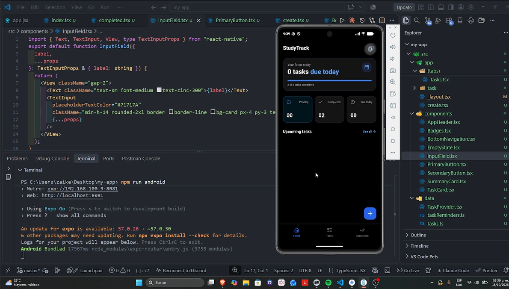

# StudyTrack
### Aplicación móvil para la organización académica

**Autor:** Erick Yongdae Kim Shin  
**Repositorio del proyecto:** https://github.com/ZaikenGG/Homework-Module-1  
**Entrega:** Borrador del proyecto — Módulo 5  
**Estado:** Diseño y planificación inicial del proyecto

---

## 1. Descripción del proyecto

**StudyTrack** es una aplicación móvil diseñada para ayudar a estudiantes universitarios a organizar sus tareas, actividades, exámenes y fechas importantes desde una sola plataforma. El propósito es ofrecer una forma práctica de registrar responsabilidades académicas, revisar próximas entregas y dar seguimiento al progreso de cada actividad.

El proyecto utiliza **React Native** para desarrollar la interfaz móvil mediante componentes reutilizables y una base de código que puede adaptarse a diferentes plataformas. Esta tecnología permite enfocar el desarrollo en una experiencia consistente y facilita la posibilidad de ampliar el proyecto a Android y, con los ajustes correspondientes, iOS. La compatibilidad final dependerá de las funciones y dependencias que se integren.

## 2. Exposición del problema

Los estudiantes suelen recibir información académica a través de diferentes medios, como plataformas educativas, correos, mensajes y notas personales. Mantener todas las fechas y actividades organizadas puede resultar complicado y ocasionar que se olviden entregas o se dé prioridad a tareas menos urgentes.

StudyTrack propone centralizar la organización académica en una aplicación móvil clara y fácil de utilizar. De esta manera, el estudiante puede consultar sus pendientes, registrar nuevas actividades y actualizar su estado desde un solo lugar.

## 3. Objetivos

### Objetivo general
Diseñar y desarrollar una aplicación móvil que facilite la organización y el seguimiento de las responsabilidades académicas de estudiantes universitarios.

### Objetivos específicos
- Permitir el registro de tareas con materia, nombre, descripción y fecha de entrega.
- Presentar las actividades pendientes de forma organizada.
- Facilitar la edición, eliminación y finalización de tareas.
- Diseñar una interfaz moderna, legible y sencilla de navegar.
- Aplicar una estructura de componentes reutilizables mediante React Native.
- Documentar el avance del proyecto y sus cambios utilizando GitHub.

## 4. Plataforma y tecnologías

### Plataforma objetivo
El proyecto está orientado principalmente a dispositivos móviles Android. Debido al uso de React Native, también existe la posibilidad de adaptar la aplicación a iOS, siempre que la configuración, las dependencias y las pruebas necesarias lo permitan.

### Tecnologías y herramientas
- **React Native:** desarrollo de la interfaz móvil mediante componentes reutilizables.
- **JavaScript/TypeScript:** lógica y estructura de la aplicación, según la configuración del proyecto.
- **Expo y Expo Router:** herramientas previstas para facilitar la ejecución, el desarrollo y la navegación entre pantallas, si forman parte de la configuración final.
- **Git y GitHub:** control de versiones, respaldo del código y documentación del proyecto.
- **Emulador o dispositivo físico:** pruebas de navegación, diseño y funcionamiento.

La selección definitiva de herramientas debe coincidir con las dependencias y archivos que realmente estén configurados en el repositorio.

## 5. Interfaz de usuario

La interfaz está dirigida al estudiante y busca que las tareas importantes se identifiquen rápidamente. La propuesta visual utiliza un estilo moderno y minimalista, con fondo oscuro, tarjetas diferenciadas, acentos azules y texto de alto contraste.

### Pantallas propuestas
1. **Inicio:** resumen de tareas pendientes y fechas próximas.
2. **Crear tarea:** formulario para ingresar materia, nombre, descripción y fecha de entrega.
3. **Detalle de tarea:** información completa y acciones disponibles.
4. **Editar tarea:** modificación de los datos registrados.
5. **Tareas completadas:** consulta de actividades finalizadas.
6. **Calendario u organización por fecha:** vista complementaria que podría incorporarse según el alcance del proyecto.

## 6. Interfaz de administrador

La versión inicial está enfocada en el uso individual del estudiante y no requiere un panel de administración independiente. Si el alcance del proyecto cambia para incluir una comunidad de usuarios o una institución educativa, podría evaluarse una interfaz administrativa para gestionar cuentas, configuraciones o reportes. Esta ampliación se considera una posibilidad futura, no una función ya implementada.

## 7. Funcionalidades principales

Las funciones previstas para la aplicación son:

- Crear tareas y asociarlas con una materia.
- Registrar el nombre, la descripción y la fecha de entrega.
- Consultar las tareas pendientes.
- Ver los detalles de una actividad.
- Editar la información de una tarea.
- Marcar una tarea como completada.
- Eliminar tareas que ya no sean necesarias.

### Posibles mejoras futuras
- Recordatorios o notificaciones de fechas próximas.
- Sincronización y respaldo de información.
- Opciones de personalización y accesibilidad.
- Filtros por materia, fecha o estado.
- Funciones de priorización de actividades.

Estas mejoras quedan sujetas al tiempo disponible y a la implementación y pruebas correspondientes. No deben considerarse funciones terminadas hasta que estén desarrolladas y verificadas.

## 8. Diseño y navegación

El flujo general propuesto es:

### Principios de diseño
- Navegación clara y consistente.
- Formularios breves y fáciles de completar.
- Jerarquía visual para destacar nombres y fechas de entrega.
- Botones con etiquetas comprensibles.
- Componentes reutilizables para mantener consistencia entre pantallas.
- Diseño adaptable a diferentes tamaños de pantalla.

## 9. Alcance y plan de desarrollo

El proyecto se organizará en las siguientes etapas:

1. **Análisis:** definición del problema, público objetivo y requisitos.
2. **Diseño:** elaboración de wireframes y definición de la navegación.
3. **Desarrollo:** construcción de pantallas y funciones prioritarias con React Native.
4. **Pruebas:** verificación de formularios, navegación y operaciones sobre las tareas.
5. **Mejoras:** corrección de errores y ajustes de usabilidad.
6. **Documentación:** actualización del README y del registro de cambios.

### Criterios de evaluación
- Las tareas se pueden registrar con información válida.
- La lista refleja correctamente los cambios realizados.
- Las acciones de editar, completar y eliminar funcionan según lo esperado.
- La navegación es comprensible y consistente.
- La aplicación se prueba en un emulador o dispositivo compatible.
- La documentación distingue entre funcionalidades propuestas y completadas.

## 10. Registro de cambios (Changelog)

| Versión | Descripción | Estado |
|---|---|---|
| 0.1.0 | Definición del problema, objetivo y público de StudyTrack | Borrador |
| 0.2.0 | Identificación de pantallas y funciones principales | Planificado |
| 0.3.0 | Documentación de React Native, plataforma e interfaz propuesta | Borrador del módulo 5 |

El registro debe actualizarse cuando se realicen cambios reales en el código o en la documentación. Antes de publicar una nueva versión, verifica que su descripción corresponda con el estado del proyecto.

## 11. Conclusión

StudyTrack busca ofrecer a los estudiantes una herramienta móvil práctica para gestionar sus responsabilidades académicas. El uso de React Native permite desarrollar una interfaz basada en componentes reutilizables y deja abierta la posibilidad de ampliar la compatibilidad a otras plataformas. La definición de requisitos, pantallas y funciones prioritarias establece una base para continuar con el desarrollo, las pruebas y la documentación durante el término académico.

## 12. Referencias

GitHub. (s. f.). *Hello World*. https://docs.github.com/es/get-started/start-your-journey/hello-world

Sánchez, J. J. (s. f.). *Taller Git y GitHub* [Repositorio]. GitHub. https://github.com/josejuansanchez/taller-git-github
